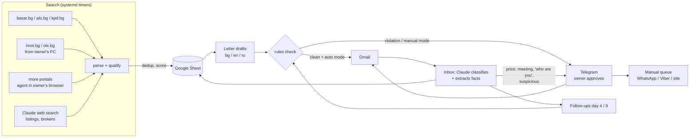

# Solar BG Outreach

An autonomous deal-sourcing agent for buying operating 1–3 MW solar (PV) plants (and projects with a building permit) in Bulgaria.
It crawls Bulgarian listing sites, qualifies and scores each plant, writes to sellers in their
own language, reads their replies with an LLM, tracks every deal in Google Sheets and pings the
owner on Telegram only when a human decision is needed.

It has run unattended on a free-tier Google Cloud VM since October 2026.

## Highlights

- **End-to-end pipeline.** Scraping → parsing → dedup → scoring → letter drafts → approval → Gmail
  → reply classification → fact extraction → follow-ups → daily digest.
- **LLM with guardrails.** Claude classifies replies and extracts facts into strict pydantic schemas,
  with one retry and then escalation to the owner. Every outgoing text goes through a regex rule
  check that runs independently of the model: no offers, no prices, no meetings, no foreign phone
  numbers, no links. Seller text is treated as untrusted input, and prompt-injection or phishing
  attempts are flagged even when the model misses them.
- **Polite crawling.** Has its own robots.txt parser (RFC 9309, since `urllib.robotparser` can't
  handle `*` and `$`), per-host rate limits and backoff on 429. It never works around blocks or
  CAPTCHAs, and it never reveals phone numbers hidden behind JavaScript.
- **Safe by default.** Nothing reaches a seller unless `DRY_RUN=false` is set explicitly. The Gmail
  client can only touch threads carrying its own label, and it has no delete calls.
- **Exactly once.** Each letter is saved to the sheet the moment Gmail accepts it, so an error later in the pass,
  a deploy or an OOM kill never sends it twice. A reply is marked as processed only after its results are in the
  sheet, so an LLM or Telegram outage delays it but never loses it.
- **Hosting costs about $0 a month.** It runs on an e2-micro VM with a budget alert on Pub/Sub; at 100% of
  the budget the VM shuts itself down. Claude API usage, mostly the daily web search, is a few dollars a month.
  Long polling makes the bot answer in seconds without webhooks.
- **Tested.** About 300 pytest tests cover parsers, rules, scheduling and robots.txt, plus whole inbox and
  sending passes on an in-memory sheet with Gmail, Telegram and LLM fakes, including failures in the middle of a pass.
  An optional paid live evaluation of the classifier runs behind `LIVE_LLM=1`.

## How it works



1. **Search** ([search.py](solar_outreach/search.py), [sources/](solar_outreach/sources)): each site module
   returns listings, [parse.py](solar_outreach/parse.py) extracts power, price, year, regime and contacts,
   and [qualify.py](solar_outreach/qualify.py) scores them against [config.yaml](solar_outreach/config.yaml).
   Rows are deduplicated by link (alo.bg by ad number), phone and email (combined with power), power + total price,
   and title + power + region. Every run records per source how many links it saw and what failed; the morning
   digest flags a source that errors, returns 0 links or has stopped running.
   Portals the crawler can't read (JavaScript-only results, form-only search, cloud-IP 403) are covered by a daily routine
   in which a Claude agent browses them in the owner's Chrome and hands the listings to `search --import`, so they get
   the same parser, criteria and dedup. The agent follows the same robots.txt rules as the crawler (sites that opt out
   of automated or Claude agents are skipped), and never logs in, solves CAPTCHAs or reveals hidden phone numbers.
2. **Drafts** ([drafts.py](solar_outreach/drafts.py)) are built from templates and sheet facts, without an
   LLM, so they contain no invented facts and cost nothing. The LLM only rewrites a draft when the owner asks for an edit.
3. **Approval** ([approval.py](solar_outreach/approval.py), [notify.py](solar_outreach/notify.py)): the owner
   sees each draft in Telegram with buttons. In auto mode, clean drafts approve themselves.
4. **Sending** ([gmail_client.py](solar_outreach/gmail_client.py)) respects daily limits and spaces letters out.
   Phone and website contacts go to a manual queue with prefilled WhatsApp and Viber links.
5. **Inbox** ([inbox.py](solar_outreach/inbox.py), [llm.py](solar_outreach/llm.py)): replies are classified into
   14 categories, checklist answers go into the sheet, and anything sensitive pauses the dialog and alerts the owner.
6. **Engine** ([engine.py](solar_outreach/engine.py)) runs everything as an idempotent pass under a lock. In daemon
   mode on the VM it checks mail every minute and long-polls Telegram in between.

## Guardrails

These rules are enforced in code ([rules.py](solar_outreach/rules.py), [inbox.py](solar_outreach/inbox.py)),
not left to the prompt:

- Letters never make offers, state a budget or prices, agree to meetings, calls, NDAs or deposits,
  or share company details.
- Letters may state only the buyer facts listed in the config. The LLM may not invent anything else.
- "Are you a bot?" or "who are you?" pauses the dialog and escalates to the owner, even when the model misses the
  question. The system never claims to be human, and outgoing text that does is flagged.
- A paused dialog (escalation, refusal, skipped by the owner) stays paused when the seller writes again: the message
  is recorded and shown to the owner, and nothing is answered.
- A refusal or "already sold" moves the contact to a do-not-contact tab. It and the blacklist apply to every
  channel (email, WhatsApp, alo.bg) and to other listings of the same seller. A bounce rate above 10% switches
  sending back to manual and returns already approved letters to the owner.
- A follow-up drafted before the seller answered is cancelled, on every channel.
- Attachments are stored in Drive (PDF, images and DOCX only) and are never opened. Links in emails are never followed.

## Tech stack

Python 3.11 · Anthropic Claude API (Haiku for classification, Sonnet for rewrites, server-side web search) ·
Gmail, Sheets and Drive APIs (OAuth desktop flow) · Telegram Bot API · requests + BeautifulSoup ·
pydantic · pytest · Google Cloud e2-micro VM + systemd timers · Pub/Sub budget alerts

## Repository layout

```
solar_outreach/
  config.yaml        criteria, limits, models (public example values)
  config.py          config + .env loading, DRY_RUN, cross-process lock
  sources/           one module per listing site, robots.txt-aware Fetcher
  parse.py           power / price / year / contacts from listing text
  qualify.py         selection and scoring
  search.py          search -> dedup -> «Станции» sheet tab
  templates/         letter templates bg / en / ru
  drafts.py          language detection, broker vs private seller, letter assembly
  rules.py           hard-rule check for every outgoing text
  llm.py             Claude wrapper: strict JSON, retry, cached system prompt
  approval.py        Telegram approval loop, limits, sending, digest
  inbox.py           reply classification, fact extraction, escalations
  followup.py        follow-ups on day 4 and 9
  owner.py           owner commands (/stats, /pause, /auto, /queue, ...), digest
  site_queue.py      CLI for the routine that sends «Ручная очередь» messages on alo.bg and WhatsApp
  alo_reply.py       CLI for the routine that reads seller replies in the alo.bg account
  gmail_client.py    Gmail restricted to the SolarBG label
  contacts.py        contact channel (email > phone > website)
  sheets.py / drive.py / notify.py / budget.py
  google_auth.py / set_secrets.py   one-time OAuth and key setup
  engine.py          main loop / daemon
deploy/              VM setup, deploy script, systemd units and timers, status.sh
tests/               pytest suite
```

## Running it

```bash
python -m venv .venv
.venv/bin/pip install -r requirements.txt      # Windows: .venv\Scripts\pip
.venv/bin/python -m pytest -q

cp .env.example .env
python -m solar_outreach.set_secrets           # Anthropic + Telegram keys (hidden input, each key verified)
python -m solar_outreach.google_auth           # one-time Google OAuth (client_secret.json from a Desktop OAuth client)
```

Real values (owner name, contacts, buyer facts, price targets) go in `solar_outreach/config.local.yaml`.
That file is gitignored and is merged over `config.yaml`, so it can override any key.

```bash
python -m solar_outreach.search --local        # print found listings, no Sheets
python -m solar_outreach.search                # write to the Google Sheet (created on first run)
python -m solar_outreach.engine                # one pass: inbox, Telegram, drafts, sending
python -m solar_outreach.engine --daemon       # run forever
```

On the owner's PC (sites that block cloud IPs, and the Claude-in-Chrome routines):

```bash
python -m solar_outreach.search --only pc      # imot.bg + olx.bg
python -m solar_outreach.search --import found.json   # listings the browser routine collected
python -m solar_outreach.alo_reply pending     # alo.bg replies to read in the account
python -m solar_outreach.site_queue pending    # alo.bg / WhatsApp messages to send
```

The operator interface (Telegram bot, sheet tabs and columns, owner summaries) is in Russian because the operator
speaks Russian. Seller-facing letters are in Bulgarian, English or Russian, chosen per conversation.

## Deployment

`deploy/deploy.sh` packs the committed code with `config.local.yaml` and `.env`, copies them to the VM and runs
`deploy/setup.sh` (`deploy.sh --code` leaves the VM's `.env` alone; `deploy/status.sh` shows the bot, the timers
and memory). setup.sh sets up the venv, 2 GB of swap and the systemd units:

- `solar-bot`: the engine daemon (memory-capped, restarted on failure, alert after 3 failures in a row; a restart
  waits for the current pass to finish)
- `solar-search-sites.timer` (3× a day), `solar-search-web.timer` (daily, with Claude web search),
  `solar-search-regions.timer` and `solar-search-brokers.timer` (weekly); search runs never overlap

Budget safety: a monthly GCP budget publishes to Pub/Sub. [budget.py](solar_outreach/budget.py) reads it, and at
100% it alerts the owner and powers the VM off.
